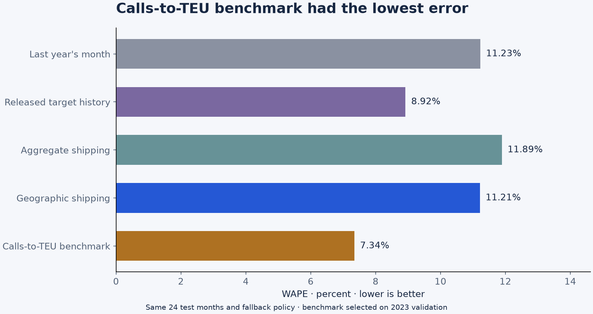

# Ports Before Reports

**The calls-to-TEU benchmark beat the geography-aware model; the gain over aggregate shipping was uncertain.**

Can keeping the geography of shipping activity improve a day-21 nowcast of monthly loaded imports? This project joins an auditable source pipeline, a protocol-locked forecasting comparison, and a separate AIS measurement study for San Pedro Bay, New York/New Jersey and Savannah.

## Actual finding

In the **24 monthly origins of 2024–2025**, the geography-aware model had **11.21% WAPE**, aggregate shipping **11.89%**, and the strongest noncandidate benchmark selected on 2023 validation—simple calls-to-TEU conversion—**7.34%**. Lower is better. Geography's **5.69% relative error reduction** versus aggregate activity is not 5.69 percentage points; its 95% block intervals include zero. Against the selected benchmark, geography's error was **52.71% higher**. Longer reporting lags also weaken the direct comparison.

The frozen decision-rule status is `PROMISING_BUT_UNCERTAIN`, **not** evidence that the geographic model is the best forecasting choice. No trading return, live accuracy, verified historical lead time or national-import coverage is claimed.

**Research decision:** do not prefer the geography-aware model on this evidence. Keep the simpler benchmark for further prospective validation; its historical win is not proof of an operational or investment edge. The reproducible pipeline and measurement work are separate engineering outputs, not a way to turn the forecasting result into a success.



| Model | Full-policy WAPE |
| --- | ---: |
| Prior-year same month | 11.23% |
| Released target history | 8.92% |
| Aggregate shipping | 11.89% |
| Geography-aware shipping | 11.21% |
| Calls-to-TEU benchmark | **7.34%** |

All five models forecast the same months. Three of 24 primary origins use the shared seasonal fallback; 21 have complete required activity features. The bootstrap resamples the same calendar blocks for both models: 10,000 replicates each at three- and six-month block lengths. Its intervals describe comparative error, not a new month's forecast range.

## What was built

- **Exact targets:** 336 monthly loaded-import TEU observations, four official reporting ports, 2019–2025. Los Angeles plus Long Beach form one San Pedro Bay gateway.
- **Exact activity:** 7,671 container-specific PortWatch gateway-days over 2019–2025. Combined LA/LB is counted once; nine documented blackout observations are null, not zero.
- **Frozen research:** 2019 warm-up, 2020–2022 development, 2023 model selection, and 2024–2025 evaluation. Eight geographic predictors versus four aggregate predictors; no deep model or outcome-tuned feature search.
- **Measurement:** NOAA 2024 cargo-vessel proxy points, candidate berth/anchorage states, bounded observed hours, queue-stock coverage, censoring and geometry sensitivities. This layer is descriptive, not a long-history congestion predictor.
- **Reviewable evidence:** source receipts, immutable predictions, independent arithmetic reconciliation and executed notebooks. This repository is a standalone research release, not a deployed forecasting product.

**Accepted measurement:** all **366 source days** (January 1–December 31, 2024), **12,408,103 cleaned cargo-proxy points**, **23,986 candidate episodes** and **1,098 gateway-day summaries**, with 21 gateway/scenario sensitivity rows. The 60 agent-assisted trajectory panels remain reviews of the original **14-day pilot**, not a new full-year validation sample. The [measurement receipt](artifacts/audit/geo_measurement_receipt.json) and [acceptance state](artifacts/audit/geo_finalization_state.json) link the verified source crops, executed code and frozen pilot; complete source partitions do not imply complete vessel detection.

**Operational comparison disagrees materially:** on matched valid dates, San Pedro Bay averaged **3.29 modeled candidates versus 0.90 reported waiting ships** (49 pairs), and Savannah **0.00 versus 4.32** (50 pairs). The populations, spatial footprints and observation times differ, so this is neither an agreement claim nor independent ground truth. In particular, a zero in Savannah's bounded candidate area cannot establish no queue. These measurement limitations do not change the locked forecasting result.

## Inspect and reproduce

**Start here:** this public repository contains code, tests, executed notebooks and reviewed aggregate results. Raw source panels, vessel-level records and the original machine configuration are intentionally excluded. The supported public replay recomputes **30 metric rows from 720 published forecasts and both primary paired-bootstrap comparisons**. It does not reacquire sources or refit the models.

Use **Python 3.12**. On Windows, from a fresh clone:

```powershell
py -3.12 -m venv .venv
.venv/Scripts/python.exe -m pip install --only-binary=:all: -r requirements.lock
.venv/Scripts/python.exe -m pip install --no-deps --no-build-isolation -e .
.venv/Scripts/python.exe scripts/reproduce_public.py
.venv/Scripts/python.exe -m pytest tests -q
```

On macOS/Linux, create the environment with `python3.12 -m venv .venv` and use `.venv/bin/python` in place of `.venv/Scripts/python.exe`. The recorded dependency environment and release checks were run on Windows; other platforms have not been verified for this release.

The public replay writes `artifacts/audit/public_reproduction_receipt.json`. It requires no credentials or network access after installation. The tests use synthetic fixtures; they are software checks, not additional empirical validation.

Inspect the saved notebooks on GitHub, but do not run the full local workflow or initialize a new run inside this historical evidence checkout. Notebook source checks, model refitting and full-year AIS reconstruction need retained inputs that are not distributed here. Read [reproducibility and scope](docs/REPRODUCIBILITY.md) for the distinction between public replay and the original local study.

## Research boundaries

- This is **current-vintage pseudo-real-time** research conducted in October 2026, not a backtest built from archived first releases. All 336 target first-release timestamps are unknown. Shipping lags of 7/14/28 days and target lags of 60/90 days are assumptions.
- PortWatch revised historical measurement, including a July 2026 vessel-universe update. Historical observation dates do not establish what was available then.
- The composite is selected-gateway loaded-import TEUs, not all U.S. imports, tonnage, prices or consumer demand. NYNJ facility/reporting boundaries remain ambiguous; its exclusion explicitly changes the target.
- NOAA broadcast cargo codes do not confirm containership identity. A stationary vessel is not necessarily delayed. Missing reception is not zero queue; approximate berth geometry is not ground truth.
- Twenty-four test months constrain inference. Multiple models, ports and sensitivities do not create more independent forecast months. Agent-assisted review and a separately coded calculation are not independent human validation.
- Raw vendor/source panels stay private by default; public material is limited, attributed and transformed. See [data terms](DATA_LICENSES.md).

## Evidence map

- [Research findings](docs/RESEARCH_FINDINGS.md) · [Interview brief](docs/INTERVIEW_BRIEF.md)
- [Frozen protocol](RESEARCH_PROTOCOL.md) · [Final lock](artifacts/protocol_lock.json) · [Locked results](artifacts/metrics/locked_results.json)
- [Independent numerical audit](artifacts/audit/independent_research_audit.json) · [Source audit](docs/DATA_ACCESS_AUDIT.md) · [Literature review](docs/LITERATURE_REVIEW.md)
- [Measurement notebook](notebooks/01_measurement_audit.ipynb) · [Locked-research notebook](notebooks/02_locked_research.ipynb) · [Execution receipt](artifacts/audit/notebook_execution.json)

Final protocol lock SHA-256: `1d853f3d8a9e9185cbaad64b44d20d7630a239c2bf45ac405fd8e90e9400fda0`.

Original project code is [MIT licensed](LICENSE). This does not license third-party data. **Sources: Kpler; UN Global Platform; IMF PortWatch** ([PortWatch](https://portwatch.imf.org/)); official loaded-import statistics via BTS and the port authorities; NOAA/MarineCadastre 2024 AIS for the separate measurement layer.
